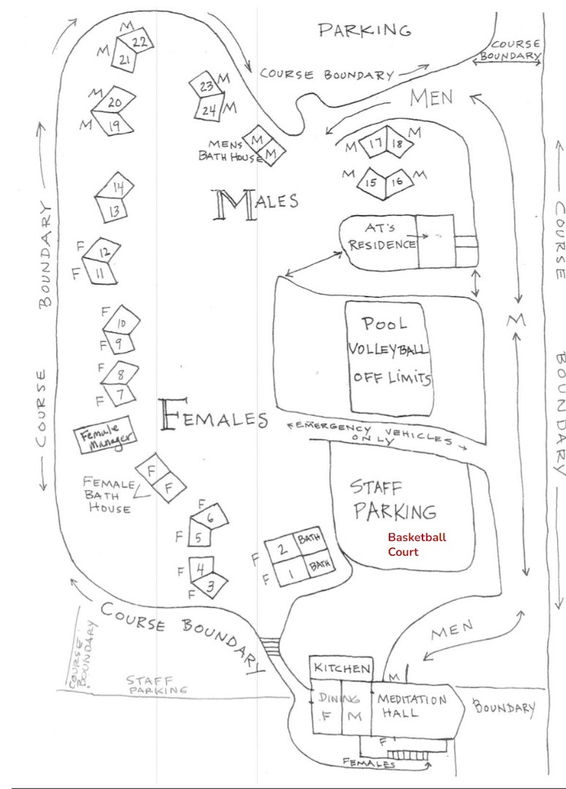

# Setup & Cleanup Info

# Occidental Course Setup

Setup and Cleanup Server Information

This page is intended for servers who are attending the Setup and/or Cleanup part (different from serving the course) of the Occidental Course. 

Only Old Students who have completed a ten-day course may come early for giving service for Set Up

Please [CLICK HERE](https://forms.office.com/pages/responsepage.aspx?id=w06SogXju0iz5JS9lfi4MztRO9s0zm9LsYpY1o5DI2VURExXVFJWSE03MFQ0QkJES0FNQVQ3OFpQTC4u&origin=lprLink&route=shorturl) to sign up if you haven't

# Overview

## Schedule:

Occidental Course 2026-27

Registration opens : 10/17

Day -2 : December 20th, Sun, (after 9am)

Day -1 :  December 21st, Mon

Day 0  :  December 22nd, Tue

Metta Day, Day 10 : Jan 1st, Fri

Course End (Day 11) and Cleanup Day: Jan 2nd, 2027 Sat (finish by noon)

## Health Protocol

Please review [Server Health Protocols](https://santosa.dhamma.org/wp-content/uploads/2026/10/2026-Occidental-Health-Protocols-Servers.pdf)

## Location:

[CYO Retreat Center, 2136 Bohemian Hwy, Occidental, CA 95465](https://maps.app.goo.gl/2YmvxfiuLhhDhCDB7)

[Printable Directions](https://drive.google.com/file/d/1KW-ZDpxURWcP6PPV4_ASBsnO88ky_uBt/view?usp=sharing)

### Group Sittings:

8am, 2:30pm, 7pm  (might be a bit adjusted on setup days)

Contact us (starting Suday 12/20/25):

707-874-0226

## What to Bring with you

- Bring TWO COVID-19 / Flu A&B 3-in-1 tests to take upon arrival and Day 4. You can purchase your tests [online](https://www.amazon.com/INDICAID-COVID-19-Antigen-Accurate-Eligible/dp/B0FDGM96ZX) or at any drugstore or purchase them from us for $17 for two tests. Take test and show negative result when you check-in at the registration table. Or please bring a photo of the negative test taken within 24-hours to be shown at registration.
- Bedding (pillow / blanket / sheet), clothes, towels, toiletries etc.   Please note that there are NO linens/pillows available on site as it's not an established Dhamma Center.
- Flashlights (extra batteries), warm jacket / sweater, umbrella / rain jacket / gloves (rain forecasted)
- Ear Plugs (if you prefer)

## Additional Details:

When you Arrive

- - Park in the volleyball court when you arrive (see diagram below)
  - When you arrive, come and check in with a server coordinator on site (in the Dhamma Hall) and you will be given information of where you can stay and what teams/tasks will be assigned to you.

[Additional FAQs](home/server-faq.md)

[Rideshare Co-ordination](https://bit.ly/occi-setup-rideshare)

### What needs to be done starting from Day -2 to Day 0 (start of course)

Target is to finish all setup by Day 0 (10am).  Many of these tasks will be broken into teams and happening in parallel.

- Unloading trucks
- Meditation Hall Setup

  - Windows
  - Partitions
  - Awnings
  - Dias / AV
  - Seating / numbering
  - Shoe racks

- Kitchen Setup

  - Prep for course
  - Food for servers during setup
- Dining Hall Setup
- Signage
- Course Boundaries
- Registration & Dana
