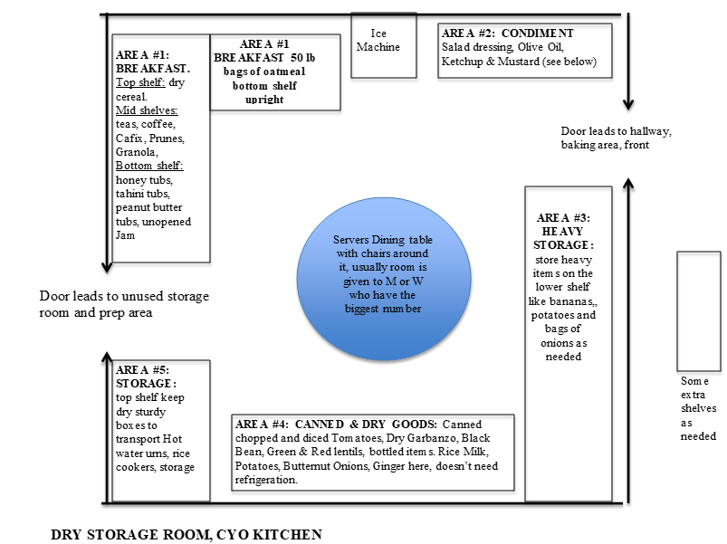
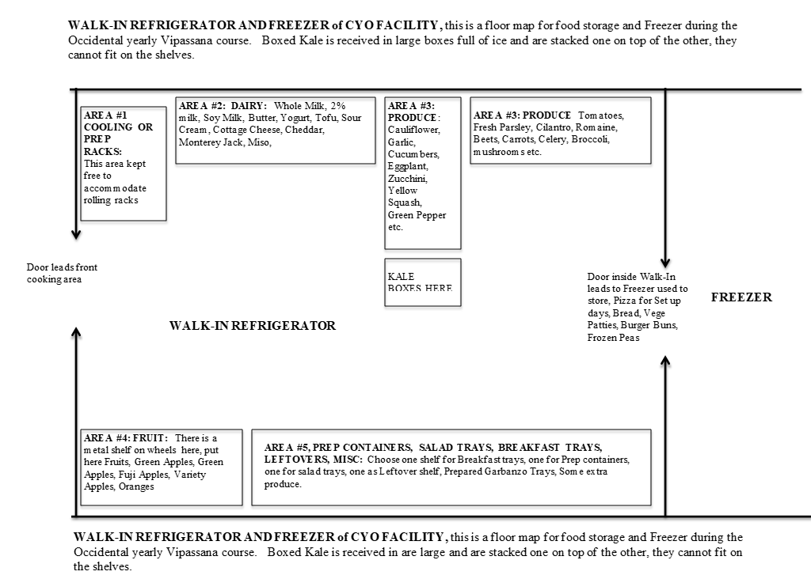

# Setup

# Kitchen Setup Map

## Dry Storage Area, CYO Kitchen

AREA #1 Breakfast: Dry cereal (Raisin Bran, Corn Flakes etc), Prunes, Instant Coffee, Cafix, All teas, Granola.  On bottom shelf all tubs of Honey, Tahini, Peanut butter, Jams 

 

AREA #2 Condiments in general:  Raisins, Sunflower Seeds, Soy Sauce, Apple Cider Vinegar, Lemon Juice, Olive Oil, Canola Oil, Brown Rice, White Rice, Ketchup, Mustard, Salsa, Cocoa Powder, Chocolate chips, baking items.  We used to keep flour here, but we now tend to store it on the large green shelf in the Baking Area..  

 

AREA #3 Heavy Storage: Use under tabletop storage for heavy items like bananas that go so fast they don’t need to be refrigerated

## Walk -In Refrigerator and Freezer

