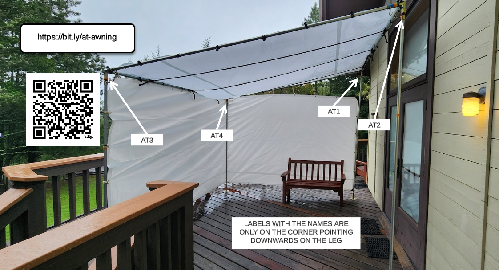
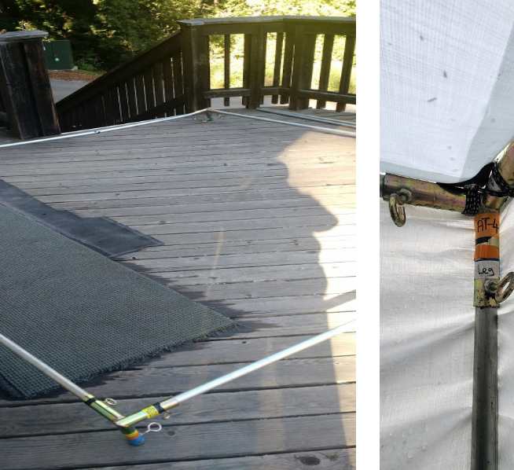

# AT Dhamma Hall Entrance

[YouTube Video, AT entrance Awnings setup](https://www.youtube.com/watch?v=KkCCv4q38e0)

A single 10’ x 10’ square is the roof. No center pole. Assemble it first on the deck paying attention to the 4 corner joints and their correct direction, put on the white tarp canopy (no valences), raise and attach the legs, feet, bolts and wing-nuts. 

And then the side panels.  The video above shows what we tried last year, but water was still pooling.  We need to add a central pole (design pending) with hooks that serves as a "roof-raiser" so water can drain continuously, as well as perhaps have hooks on them so people can use that for hanging coats etc.

And with that, awnings are done.  😄

