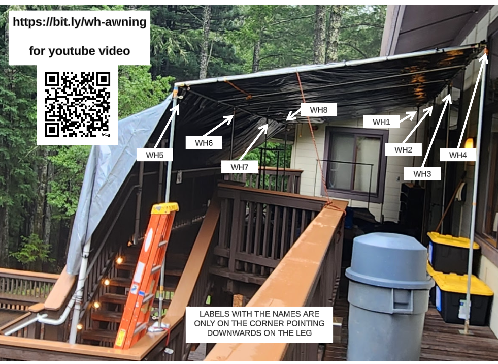
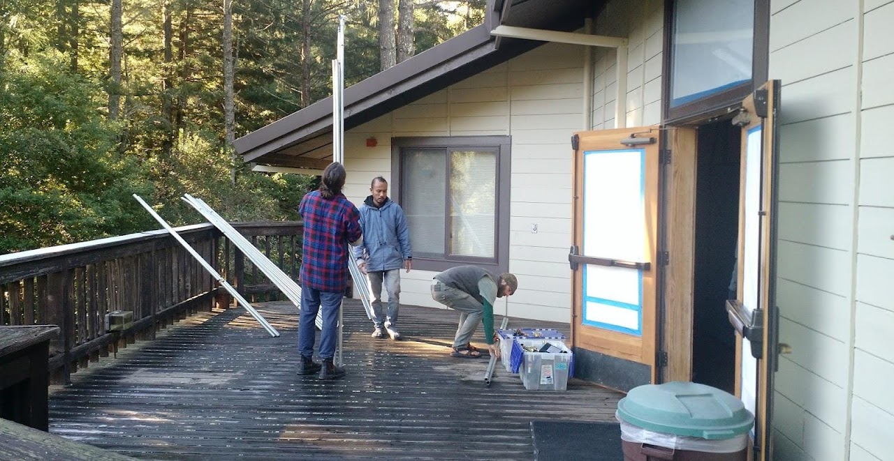
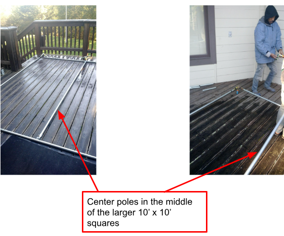
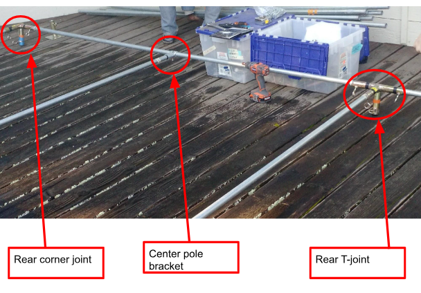
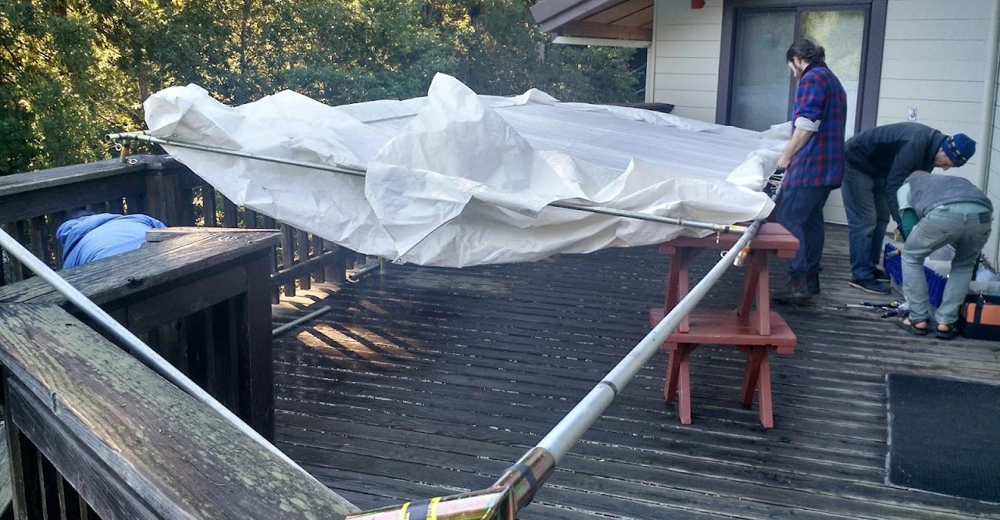
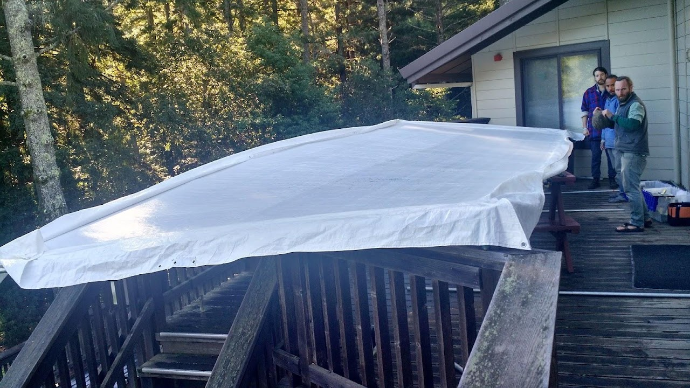
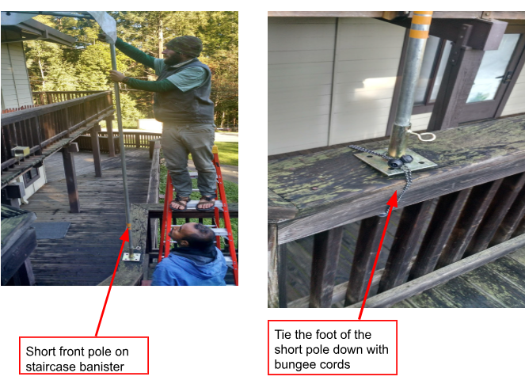
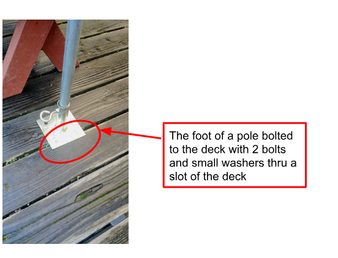
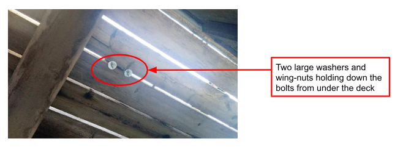

# Womens Dhamma Hall Entrance

[YouTube Video, Occidental course setup - Womens side Awnings (Hall entrance)](https://www.youtube.com/watch?v=-DiTbdK1aeE)

Start by clearing off the deck outside the women’s dhamma hall entrance. Make sure to remove all the deck furniture and especially the metal coat racks that can hurt if you bump into them while assembling this contraption. All these items can be moved near the AT entrance.  You’ll bring most of these items back later.

Bring out all the hardware and separate the poles by size.

Sizes:

- 10’ long and used to construct the roof.
- 9’ and are used to construct the rear legs (the legs that will be closest to the wall of the building).
- 8’ long and are used to construct the front legs of the awning.

Take a look at the [video](https://www.youtube.com/watch?v=-DiTbdK1aeE) to make sure you are picking the right poles for the right location.  This will save a LOT of time.

The Roof

Construct the roof frame of the awning on the deck. 

The roof consists of three 10’x10’ squares connected together.  So, lay out the 10’ long poles and the relevant joints (4 corner joints and 4 T-joints), as well as the center poles on the deck (each square will have one center pole, which mainly provides better tension for the large roof tarp and also provides greater strength to the roof). 

Make sure that the roof frame poles are fully within each joint. If not, the large roof rectangle (10’ x 30’) will be too big and the tarp will not fit properly.

### The Joints

There are corner joints (3 poles connect to them) and center t-joints (4 poles connect to these). The rear of the awning is taller than the front. The roof is sloping downwards. The joints have to be chosen correctly for the front and rear so the angle of the roof is correct. This is a bit tricky because choosing the joints could be a bit confusing.  The orange (for rear poles) and orange/black (for front poles) tape markings on the joints can help. Here is another description that may help:

There are right and left handed joints. Look for the end of the joint that matches the leg pole. Look for the weld seams. The shorter piece of the tube always faces into the structure lengthwise.

Take a close look at a few joints.  You’ll figure them out!!

### The Tarp

In 2024, we started using a really big tarp with 30ft x 20ft.  The long end runs along the building (parallel to the hall entrance), and the longer end flows over the railing providing an almost full coverage for the patio and a few steps going down. Now start putting the tarp on the roof. This is a white tarp with valences (short overhang flaps). Start with one end and attach the tarp to the roof frame with bungee balls. There is an easy method to put the bungee balls on (so they don’t snap out of your hands and hurt you!). Feed the bungee through the grommeted holes (from top for the corners, from bottom for the sides), wrap the bungee around the pole and then loop the end over the ball.  The ball is never pulled, it’s only the bungee cord that is being pulled!

Connect the corners of the tarp at one end of the frame first and then start bungeeing the sides. Make sure the tarp is taut on the roof frame.  At some point you’ll have to lift the frame to complete putting on the tarp.  Here is what we did:

Raising the Roof!

Once the tarp is on the roof, you are mostly done. Now get a few more people to help you lift the roof up and attach the legs. Note that the 9’ poles go in the rear and the 8’ in the front. Except for the one front leg that is a short one and will sit on the banister  (see photos below).  Put the feet on the legs.

Once the awning is in its proper position, with the rear touching the building wall, the feet are bolted down on the deck. Align the feet so that a slot of the deck shows and then put a bolt thru. The wing-nut is screwed on from under the deck (go downstairs, stand on a ladder or table and screw it on).

At least one bolt should be on each foot. Two is better.

