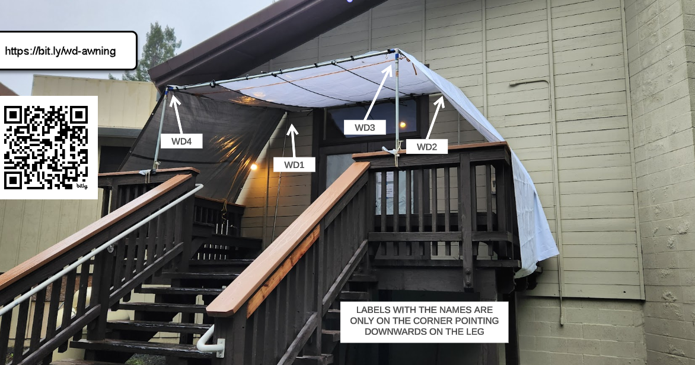

# Womens Dining Hall Entrance

[YouTube Video, Awnings setup - Womens dining hall entrance](https://www.youtube.com/watch?v=wpzFGE1fgxA)

This is also a single 10’ x 10’ roof canopy with no central pole. Assemble the roof frame first paying close attention to the 4 corner joints and making sure they are pointing in the right direction. 

The rear legs are 9’ tall, but the front legs sit on top of the staircase banisters and are shorter. These legs are anchored to the banister by using bungee cords. Use more than one cord to get a robust anchor. The rear legs are bolted on as shown earlier in the [women's dhamma hall entrance awning setup](womens-dhamma-hall-entrance.md).

