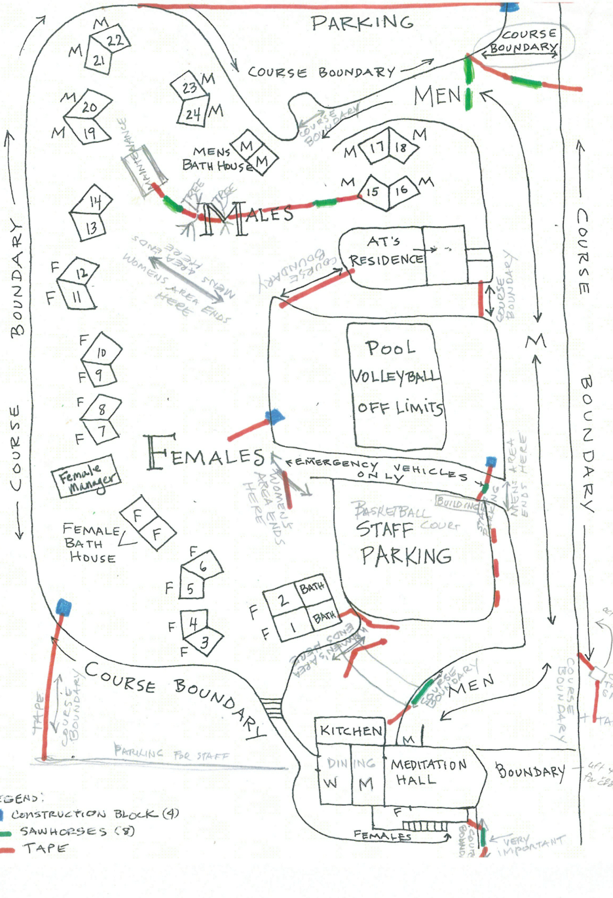

# Boundary

# Boundary Setup Details

This page outlines the essential procedures for setting up and managing course boundaries, ensuring a clear and safe environment for all participants and staff. 

See Diagram Below for additional details

## Pre-Course Boundary Set Up

This section details the tasks to be completed by the Pre-course Boundary Team before the course officially begins. This typically requires two people for 1.5 days.

Required Materials:

- - Work truck (usually Jefferey’s - or if anyone else available with a truck)
  - Drill and screws
  - Approximately 5 rolls of pink tape
  - Approximately 5 rolls of yellow caution tape (prioritize old caution tape first)
  - Course boundary signs
  - Plastic sawhorses
  - Rope

### General Principles:

- - Tape Application: Pink and caution tapes should be secured tightly at around ~4 feet high to prevent them from dragging due to wind and weather. Avoid setting them so high that they invite walkers to go underneath.
  - Moveable Boundaries: Plastic sawhorses are specifically reserved for any location that requires a moveable boundary during the course.
  - Long Distances: For long distances, such as the outer course boundary, course boundary signs and rope should be used.

### Specific Pre-Course Placements:

Sawhorse Placements:

- - Use two sawhorses for the boundaries between the basketball and volleyball courts (male and female areas).
  - Use one sawhorse for the road leading to parking above the men’s area.
  - Use one sawhorse (if necessary) for the road at the start of the course area, specifically between the meditation hall and the hillside on the Men’s side.
  - Leave one sawhorse at the fence near the female area and the back of the kitchen. This sawhorse should be equipped with tape so it can be easily moved across the road once the course begins.
  - Utilize any remaining sawhorses for long areas to prevent tape from drooping excessively.

Sign Placements:

- - Place a Course Boundary sign between Building 20 and Building 21.
  - Place a Staff Only sign at the AT residence.
  - Cover the Chapel Trail sign and any other trail signs.

Tape Placements & Buffer Areas:

- - Leave caution tape tied at several entrances to the basketball courts, ready for managers to secure on Day 1.
  - Set up two lines (using plastic sawhorses and lengths of tape, ready to be tied by managers on Day 1) to create a buffer between male and female accommodations. This applies to Building 14 across to Building 15 (if 13-14 are Female) or Building 12 across to Building 15 (if 13-14 are Male).
  - Establish a buffer area under the meditation hall to create a gap between men’s and women’s areas. This involves setting tape at the bottom of the stairs, near the female registration area, to allow female students to use the stairs but limit their walking distance underneath. Another tape should limit the male student walking area and close off the AT’s stairs (ATs will walk under this tape). Note: This part needs verification.
  - Leave tape ready to be tied across the upstairs deck to the left of the main male entrance.
  - Rope off trailheads in the women’s grass area and cover their signs. Verify with CYO and ATs whether women are permitted to use this grass area and adjust the boundary accordingly.

## Day 1

For Male Manager

- Move sawhorse across the road to the parking lot.
- Move sawhorse across the exit from the basketball court parking and volleyball court. Note that this is an emergency access road, so the boundary must be moveable.  Make sure no cars are parked here.
- Tie caution tape across the several entrances to the basketball courts.
- Move sawhorse(s) across the road behind the kitchen at the loading dock fence across to the “no vehicles please” sign.
- Tie tape across the upstairs deck to the left of the main male entrance.
- Move sawhorse across the main road entrance from the cluster of trees.
- Tie tape across the path from the same cluster of trees to the railing of the downstairs deck.

For Female Manager

- Move sawhorse from the fence behind the kitchen across the road to the garden. Note that this is an access road, so the boundary must be moveable.
- Tie tape near Room #4 downstairs to the rail.
- Move sawhorse(s) across two roads between the volleyball and basketball courts. For at least one of these two entries to the female side, this is an emergency access road, meaning the boundary must be moveable.
- Tie caution tape across several entrances to the basketball courses.
- Check that the tape under the meditation hall correctly creates a buffer between the male and female areas.
- Check that the two boundaries between the male and female areas near Buildings 14 are set up correctly to create a buffer between the two.
