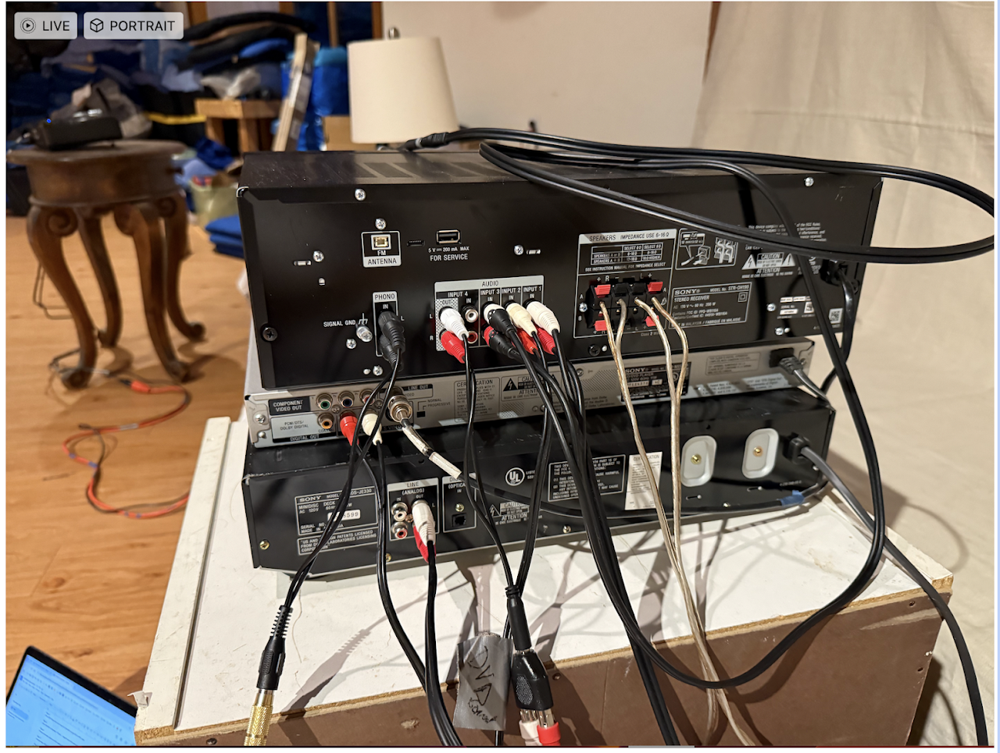
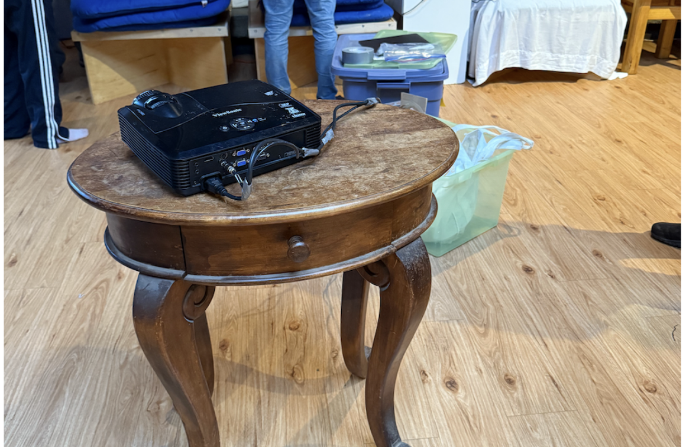
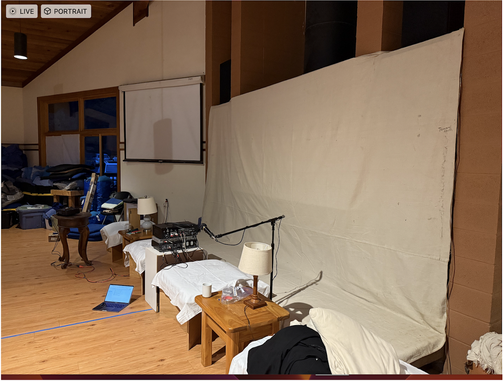

# Audio & Video

## AV Instructions

Step 1.

Stack the three devices on a white table/cupboard

1. Disc player
2. DVD player
3. Amplifier (on the top)

Set the projector on a different table

Speaker on top of the space above the fire place (one on each side)

Step 2:

Connect power for all three devices and the projector

Step 3: 

From Disc Player line out to Input 1 in Amplifier via the RCA to RCA cable

Step 4:

From DVD Player line out to input 2 in Amplifier via tbe RCA to RCA cable

Step 5:

From Amplifier to Speaker -- R and L -- regular wire of the speakers

Step 6:

Phone connection (Iphone to RCA cable) to Input 3 of the Amplifier

Step 7:

Headphones -- RCA to RCA) Amplifier out to Headphones

Step 8:

Mic to RCA to Phono In of the Amplifier

Step 9:

Video: Line out of the the DVD goes to S-Video In of the Projector

## Canvas Instructions

Select 14 x 12 canvas

Staple on the top and below the speaker

