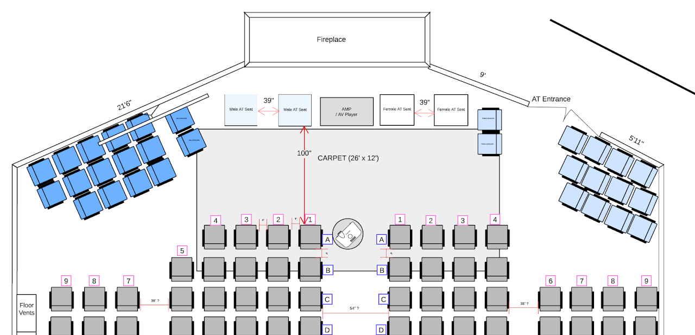

# Overall Layout

- When should this be done:   Day -2 start.  This task will take both days at least to complete including all the different parts of the hall.
- How many people needed:  10-12 at least with 2-3 leads guiding the rest of the team.
- Tools and materials needed:  Measuring tape, brooms to clean floors, painters tape, printed copies of the schematic.
- Estimated time: 2 full days :)

[Dhamma_Hall_Updated_Oct2025.pdf](https://drive.google.com/file/d/122kiLFGz4D33ZF3IChGlWAJPGH4xK_xT/view)

Dhamma\_Hall\_Updated\_Oct2025.pdf

Sequence of events:

- Create piles of 2x2's, cushions, toppers on the side, also away from the windows, as window papering will need to happen.
- Floors need to be cleaned / mopped eventually before the cushions are laid out (likely Day -1)
- Start by reviewing the diagram and measuring and marking where the chowkis will be positioned.  Everything will anchor off of that.
- Key measurements:

  - Distance from the AT seat to the first row : 100 inches
  - Column distance between column 1,2,3 : 8 inches
  - Row distance between row A,B,C... : 9 inches (or one normal tissue box has usually been the same)

