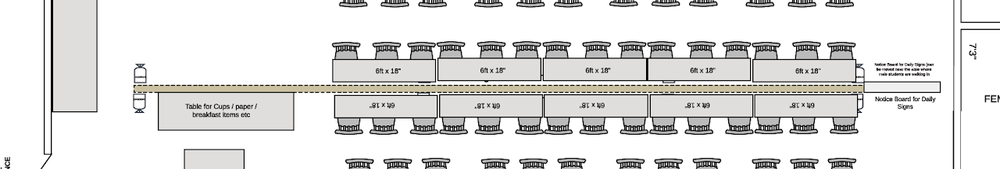

# Dining Hall Partition

- When should this be done:   Day -2.  We will need basic tables for initial dining on the first day, however this will need to be updated on Day -1 as the partitions are being built and the sections are laid out properly.
- How many people needed:  8 folks approx for dining tables.  2-3 people for dining partitions.
- Tools and materials needed:  Measuring Tape, toolbox and wrenches for the dining hall partition
- Estimated time: 3-4 hours

## Diagram of the Partition:

Review the overall view the other page for [mens](mens-dining-hall.md) or [womens](womens-dining-hall.md) dining hall overview.

Under the tables, on every pole, we require sandbags to be placed, so people won't trip, and additionally it will provide support to the partitions.  There should be a total of 8 sandbags that should be available to use.

## Here are some older videos that demonstrate how to set up the hardware for the partitions:

[VID_20131220_130023.mp4](https://drive.google.com/file/d/0ByTri-d_UoBYd2NtRWtjcGZZSWc/view)

VID\_20131220\_130023.mp4

[VID_20131220_140308.mp4](https://drive.google.com/file/d/0ByTri-d_UoBYdjFIX1FlRWJ2UkE/view)

VID\_20131220\_140308.mp4

[VID_20131220_142441.mp4](https://drive.google.com/file/d/0ByTri-d_UoBYSUVrZjZBY09JbW8/view)

VID\_20131220\_142441.mp4
