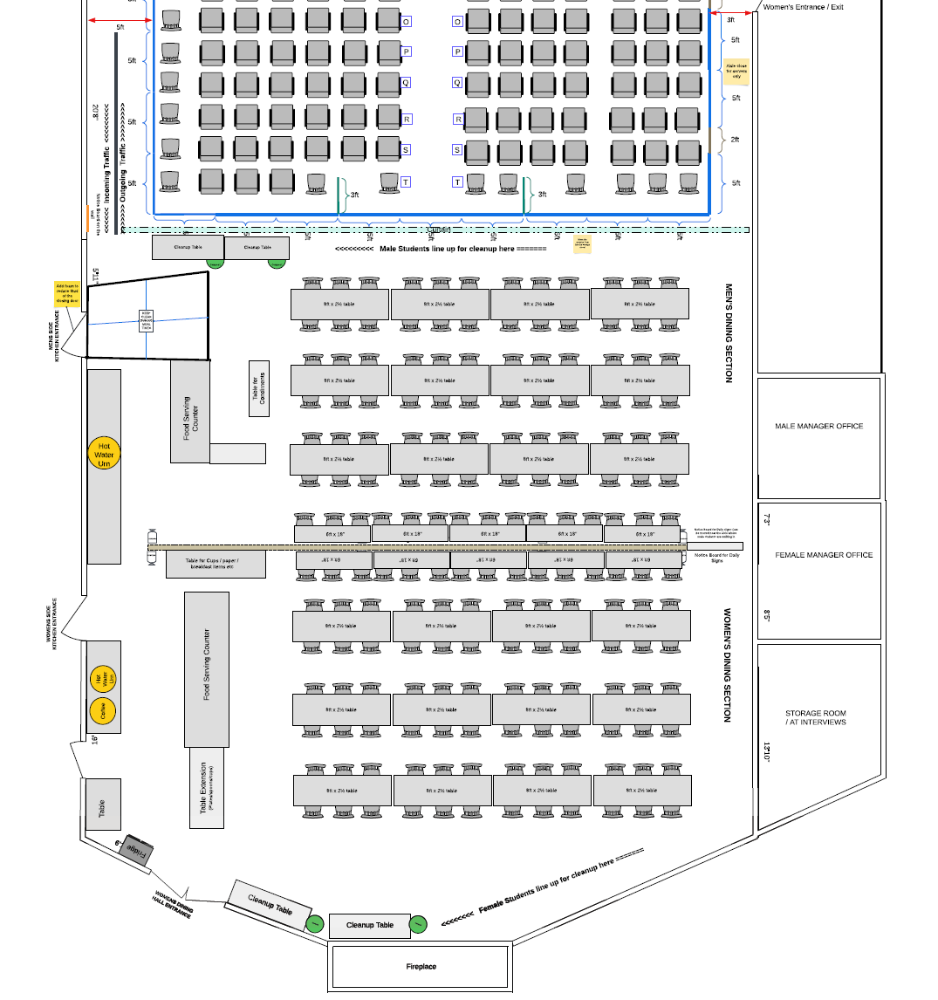
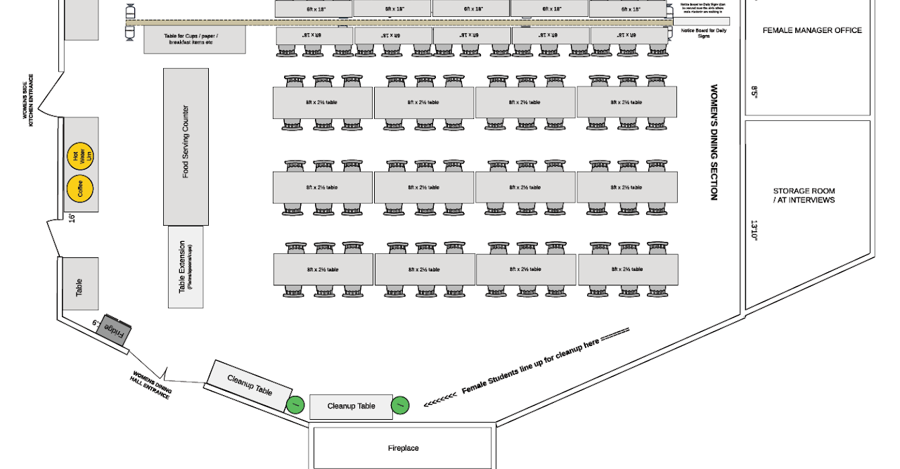
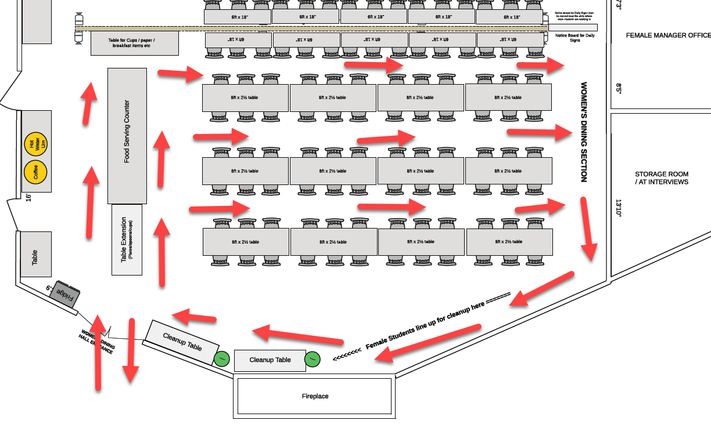

# Women's Dining Hall

# Dining Hall Setup - Women

- When should this be done:   Day -2.  We will need basic tables for initial dining on the first day, however this will need to be updated on Day -1 as the partitions are being built and the sections are laid out properly.
- How many people needed:  8 folks approx for dining tables.  2-3 people for dining partitions.
- Tools and materials needed:  Measuring Tape, toolbox and wrenches for the dining hall partition
- Estimated time: 3-4 hours

## Women's section of the dining hall:

- Review before setting it up.
- There is a new thin set of 4 tables along the partition for more seating.

## Traffic Flow:

This is the anticipated flow for the men's dining hall traffic.  It will not always be possible, but the dining managers should understand this and help guide students the first day to set this pattern early.  We should also have printouts on the walls, and the markings on the floor to indicate where the line forms to clean up before exiting.

## Reference from 2024 :

However, keep in mind, this is older and starting 2025, layout with the central partition having narrow tables around the partition in the dining hall on both sides.

[Occidental course dining halls_post course_2024:25.MP4](https://drive.google.com/file/d/1xCf9Vt9nJ4akE9AiAXdGpV-NnQzQd4j7/view)

Occidental course dining halls\_post course\_2024:25.MP4
